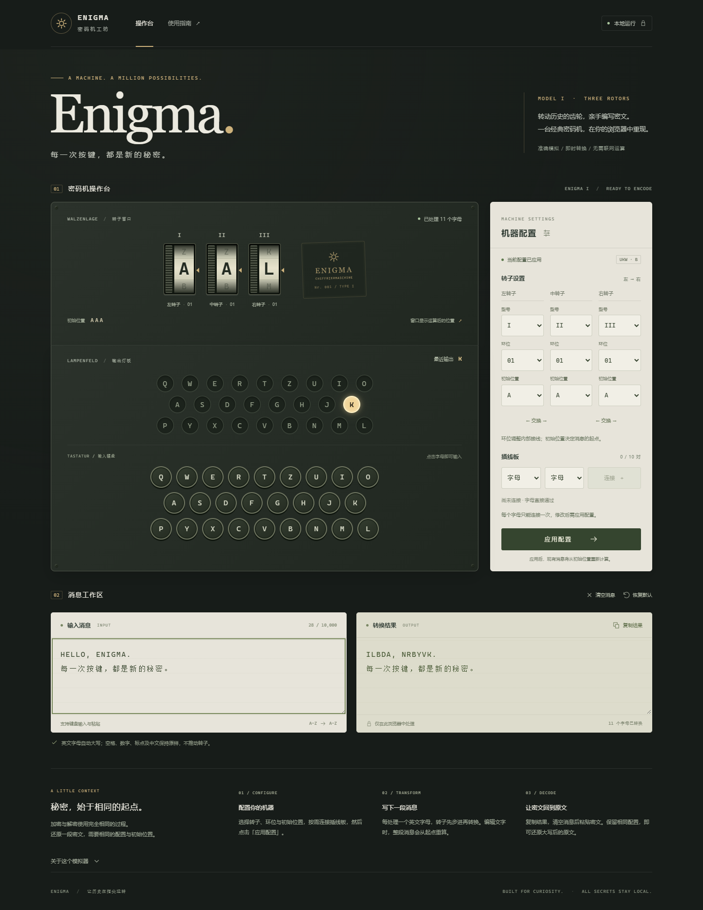

# ENIGMA · 密码机工坊

一个复古仪器风格的 **Enigma I 网页模拟器**。配置转子、连接插线板，在浏览器中体验历史密码机的字母转换与双步进机制。

使用 React、TypeScript 和 Vite 构建，纯前端运行，无需账号或后端。消息与配置只保留在页面内存中，刷新即重置。



[查看手机界面](docs/preview-mobile.png) · [算法与数据来源](docs/SOURCES.md) · [验证记录](docs/VALIDATION.md) · [发布前隐私检查](docs/PRIVACY.md)

## 功能

- 三转子 Enigma I，从 I–V 中选择三个不同转子，固定使用反射器 B。
- 独立设置环位和初始位置，支持最多十对插线及转子交换。
- 编码前步进，模拟中间转子的双步进机制。
- 文本输入、粘贴、屏幕键盘、输出灯板和一键复制。
- 桌面与手机布局，支持键盘操作和减少动态效果偏好。
- 本地字体、SVG 和 CSS，无第三方追踪脚本或外部字体请求。

本项目用于历史体验、学习与娱乐，**不适合保护现代敏感信息**。

## 快速开始

需要 Node.js 24 或更高版本及 npm。在项目目录执行：

```sh
npm ci
npm run dev
```

打开终端显示的本地地址。默认服务仅监听 `127.0.0.1`。如需通过局域网在手机访问，可运行：

```sh
npm run dev -- --host 0.0.0.0
```

然后使用电脑的局域网地址打开页面。

Windows 用户安装依赖后，也可以在文件资源管理器中双击 `start.cmd`。脚本优先查找系统 Node.js；系统未安装时，会尝试本机已有的 Codex 内置运行环境，不修改系统设置。关闭命令窗口即可停止服务。只启动服务、不自动打开浏览器：

```bat
start.cmd --no-open
```

## 如何使用

1. 展开「机器配置」，选择转子、环位、初始位置和插线。
2. 点击「应用配置」。配置草稿不会立即改变当前结果。
3. 在「输入消息」中输入文字，或点击屏幕键盘追加字母。
4. 点击「复制结果」获取密文。
5. 解密时保留相同配置，清空消息后粘贴密文，即可还原大写后的原文。

默认配置：转子 **I / II / III**，环位 **01 / 01 / 01**，初始位置 **AAA**，无插线。例如，默认配置下 `AAAAA` 转换为 `BDZGO`。

### 交互约定

- 仅转换 ASCII 英文字母，小写自动转大写。中文、数字、标点、空格、换行及其他 Unicode 字符保持原样，不推进转子。
- 编辑消息或应用配置后，整段消息从初始位置重新计算。窗口显示运算后的位置，灯板保留最近一个转换字母的输出。
- 交换转子时，对应环位和初始位置随转子一起移动。
- 消息上限为 10,000 个 UTF-16 单元，部分表情占两个单元；超限操作整次拒绝，不截断。
- 「清空消息」保留配置；「恢复默认」同时清空消息和配置草稿。
- 支持中文输入法组合输入。复制失败时会选中输出，便于手动复制。

字母窗口、非字母保留、删除重算和持续点灯是网页交互设计，并非实体机器操作的完整复刻。

## 开发与验证

| 命令 | 说明 |
| --- | --- |
| `npm run dev` | 启动本地开发服务 |
| `npm run check` | 依次执行类型检查、ESLint、单元/组件测试和生产构建 |
| `npm test` | 运行 Vitest 测试 |
| `npm run test:watch` | 监听文件并重新运行测试 |
| `npm run test:performance` | 检查 10,000 个字母的核心运算耗时 |
| `npm run test:browsers:install` | 安装端到端测试所需浏览器 |
| `npm run test:e2e` | 构建并运行跨浏览器端到端测试 |
| `npm run build` | 生成 `dist/` 静态资源 |
| `npm run preview` | 本地预览生产构建 |

端到端测试覆盖 Chromium、Firefox、WebKit 和 375px 移动布局，包括历史测试向量、输入法、超长输入、复制失败、刷新重置、网络请求及本地存储检查。浏览器默认安装在 `.cache/playwright`，可用 `PLAYWRIGHT_BROWSERS_PATH` 覆盖；也可用 `ENIGMA_CHROMIUM_CHANNEL=chrome` 或 `msedge` 复用本机浏览器。

## 构建与托管

```sh
npm ci
npm run check
```

将生成的 `dist/` 内容交给静态网站托管服务即可。资源使用相对路径，支持子目录部署；`npm run preview` 用于本地检查。

首次打开或刷新需要获取页面资源；加载完成后的密码机运算不依赖网络。当前未实现 Service Worker 离线缓存。

## 隐私与上传 GitHub

应用代码不上传消息，不将消息或配置写入地址栏、日志、Cookie、Local Storage 或 Session Storage。复制按钮仅在点击时将结果写入系统剪贴板。页面中的参考链接只有在主动打开时才访问外部网站。

发布前的文件、截图元数据及运行行为检查见 [隐私检查记录](docs/PRIVACY.md)。这份记录对应检查时的文件版本，后续新增文件需要重新检查。

源码、锁文件、测试、`public/` 和 `docs/` 可一起提交。`.gitignore` 已排除依赖、构建产物、缓存、工具目录、测试报告、环境变量文件、常见私钥及本地编辑器配置。不要直接上传整个工作目录；网页上传不会应用本机的 `.gitignore` 规则。

如果是尚未初始化 Git 的源码副本，可以先执行：

```sh
git init -b main
git add .
git diff --cached --stat
git diff --cached
```

确认暂存内容后再提交并推送到自己的仓库。提交前确认 Git 的 `user.name` 和 `user.email` 是愿意公开的信息，这些字段会进入提交记录；需要隐藏邮箱时，使用 GitHub 账户提供的 noreply 邮箱。

## 项目结构

```text
src/
  core/             接线目录、配置校验、进位、消息转换及核心测试
  components/       配置面板、本地 SVG 图标
  session.ts        已应用配置、草稿和消息的状态管理
  App.tsx           操作台、消息编辑和使用说明
  *.css             设计变量、CSS Modules 与响应式布局
tests/              跨浏览器端到端测试
scripts/            浏览器测试与预览截图脚本
public/             本地静态资源
docs/               界面预览、算法来源、实施和验证记录
start.cmd           Windows 启动入口
```

核心接口为 `validateConfig`、`stepRotors`、`encodeLetter` 与 `processMessage`。配置和位置均按操作者视角的左、中、右排列，内部位置与环位为 0–25；核心函数不修改调用方传入的数据。

## 参考资料

- [Crypto Museum：Enigma 接线](https://www.cryptomuseum.com/crypto/enigma/wiring.htm)
- [David Hamer：中间转子的双步进](https://www.cryptomuseum.com/people/hamer/files/double_stepping.pdf)
- [Py-Enigma：历史通信样例](https://py-enigma.readthedocs.io/en/latest/guide.html)

具体接线、算法约定和固定测试向量见 [docs/SOURCES.md](docs/SOURCES.md)。

## 许可证

项目采用 [MIT License](LICENSE)，项目署名为 `Enigma Workshop contributors`。允许使用、修改、分发及商用，复制或分发本项目代码时需按许可证要求保留版权声明和许可文本。

第三方依赖及引用材料保留各自的许可证和权利声明。

## AI 辅助开发

本项目使用 OpenAI Codex 辅助开发。
